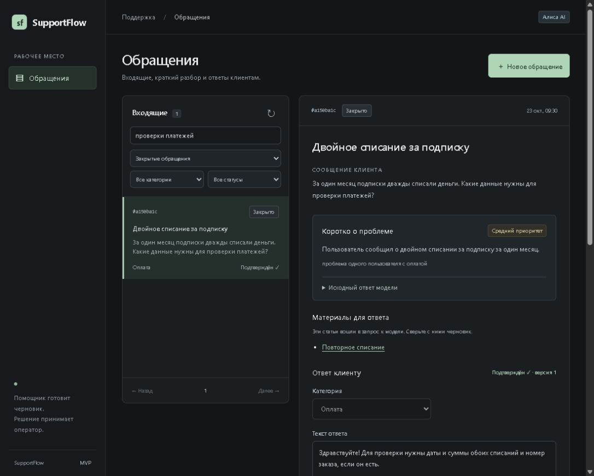

# SupportFlow

Локальная поддержка на Go с Алисой AI: разбор обращения и черновик по базе знаний. Оператор находит обращения, оценивает черновик, подтверждает ответ и закрывает вопрос. Правки остаются в истории.

**Go · PostgreSQL · pgx · Docker · Yandex AI Studio**



## Запуск

Нужен Docker Desktop с Linux containers.

```powershell
git clone https://github.com/eclipse-vlr/SupportFlow.git
cd SupportFlow
Copy-Item .env.example .env
docker compose up --build -d
```

Откройте [localhost:8080](http://localhost:8080). В форме есть готовые примеры; по умолчанию включён деморежим без запросов к модели.

Для Алисы AI задайте в `.env`:

```dotenv
LLM_PROVIDER=yandex
YANDEX_API_KEY=секретный_ключ
YANDEX_FOLDER_ID=ID_каталога_Yandex_Cloud
```

[Получить ключ](https://aistudio.yandex.ru/ru/docs/ai-studio/operations/get-api-key), настроить API-биллинг и применить настройки: `docker compose up -d --force-recreate app`. Текст обращения передаётся Яндексу, ответ проверяет оператор. Подтверждение сохраняет ответ в приложении; отправка клиенту выполняется отдельно.

## Проверка

```powershell
docker compose --profile tools run --rm check
```

Форматирование, `go vet`, тесты с `-race` и PostgreSQL. [CI](https://github.com/eclipse-vlr/SupportFlow/actions/workflows/ci.yml) запускает эти проверки и сборку Docker-образа при push и pull request. Платный API не вызывается.

[Как устроено](docs/development.md) · [Статьи](internal/knowledge/articles) · [Алиса AI](docs/evaluation.md) · [Проверки](docs/mvp.md)

Проект работает локально, без учётных записей. Очередь, обращения и история сохраняются в PostgreSQL. Остановка с сохранением данных: `docker compose down`.
