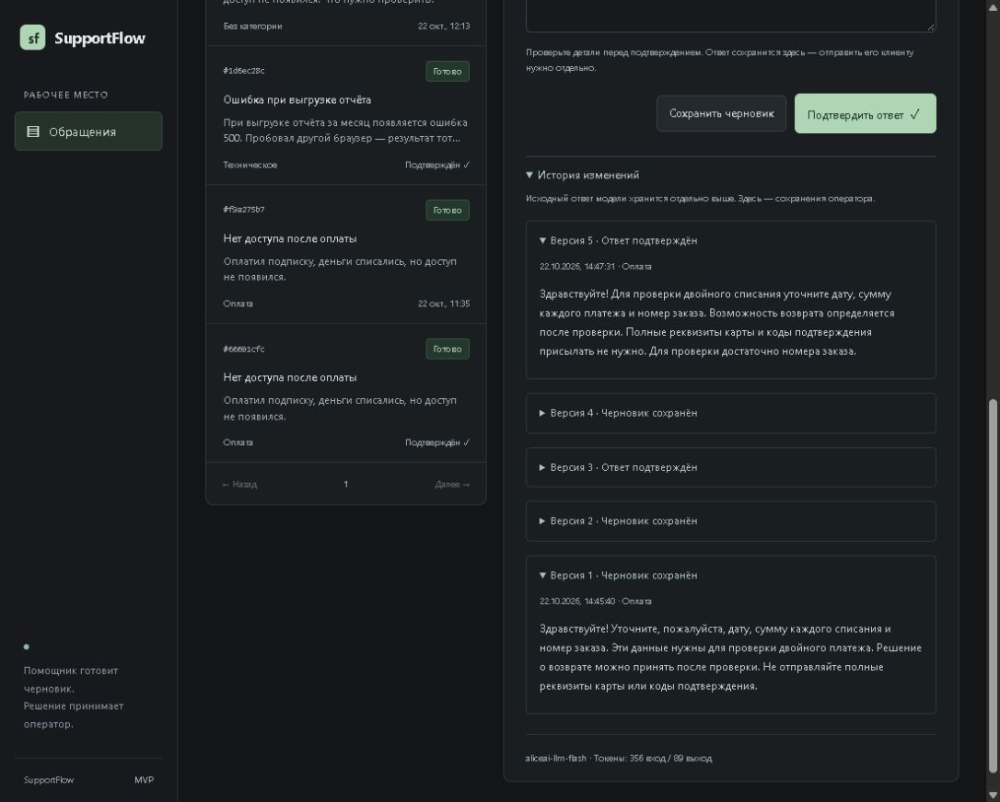

# Проверка MVP

Проверено 22 октября 2026 года. Это завершённый локальный сценарий одного оператора: обращение → анализ → правки → подтверждение → история. Отправка ответа клиенту остаётся отдельным действием вне приложения.

## Результаты

| Сценарий | Проверка |
|---|---|
| Создание обращения в браузере | Сообщение сохранилось, обработалось Алисой AI и появилось в карточке |
| Настоящий ответ модели | `aliceai-llm-flash`, категория `billing`, 356 входных и 89 выходных токенов |
| Правки и подтверждение | Два черновика и подтверждение сохранились как отдельные версии |
| Копирование ответа | Кнопка доступна для подтверждённого текста и блокируется при несохранённых правках; браузер показывает результат операции |
| Конкурирующее изменение | API сохранил новую правку; старая форма получила конфликт и сохранила несохранённый текст |
| Выход из конфликта | Актуальная версия загружена в форму и подтверждена; в итоге пять записей истории |
| Исходный ответ модели | Не изменился после правок и подтверждений |
| Повтор сохранения после потери ответа | Тот же запрос вернул существующую версию, без лишней записи истории |
| Страницы истории | Версии загружаются от новых к старым, курсор не повторяет записи |
| Неизвестное обращение | Запрос истории вернул `404` |
| Перезапуск приложения | Ответ, подтверждение, анализ и все пять версий остались без изменений |
| Обновление существующей базы | Старая правка сохранена как `imported`; версии схемы — 1 и 2 |



## Автоматические проверки

```powershell
docker compose --profile tools run --rm check
```

Прошли форматирование, `go vet`, тесты с `-race`, интеграционные тесты PostgreSQL, `go mod verify` и проверка демоправил. Добавлены проверки:

- Сохранение снимков черновиков и подтверждений, неизменность анализа модели.
- Восемь конкурентных записей с одной ревизией: одна успешная, остальные получают конфликт.
- Ошибка добавления истории откатывает изменение последнего ответа.
- Перенос старой правки и повторный запуск миграции без дублей.
- Обязательная ревизия в API: отсутствие, `null`, отрицательное значение и неверный тип отклоняются.

Приложение собирается командой `docker compose up --build -d`. После перезапуска `/readyz` возвращает `ready`, провайдер в `/api/v1/config` — `yandex`.

Качество модели проверяется отдельно от тестов приложения: [результаты оценки на учебных обращениях](evaluation.md).

## Как показать проект

1. Создать вымышленное обращение о двойном списании или ошибке отчёта.
2. Дождаться анализа, раскрыть исходный ответ модели.
3. Исправить черновик, сохранить его и подтвердить ответ. Кнопкой «Скопировать ответ» перенести подтверждённый текст для отправки клиенту.
4. Открыть историю и сравнить версии. Обновить страницу: данные остаются в PostgreSQL.

Для демонстрации без API-ключа используйте `LLM_PROVIDER=demo`; в этом режиме анализ выполняют правила, а не модель. Подключение почты, авторизация и работа нескольких операторов в этот MVP не входят.
